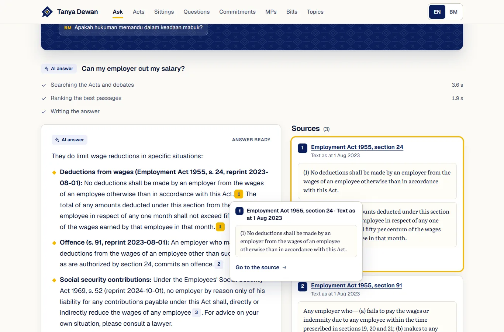
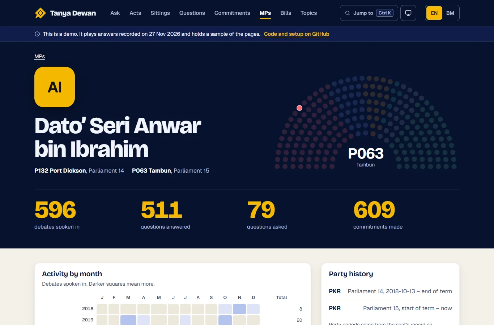
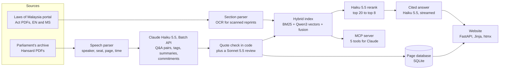

# Tanya Dewan

**Ask Malaysian law and Malaysia's Parliament a question in plain English or Malay, and get an
answer that shows exactly where it came from.**

[Try the demo](https://shanahan-suresh.github.io/tanya-dewan/) · it plays answers recorded from
the full system and holds a sample of the pages. To ask your own questions, run it yourself
(below).


*Tanya Dewan* means "Ask the Dewan" (the Dewan Rakyat is Malaysia's lower house of Parliament).
It reads two public records:

- **The law:** 1,586 Acts in English and Malay, cut into 66,026 sections.
- **The debates:** every Dewan Rakyat sitting of the 14th and 15th Parliaments (2018 to October
  2026), with its Special Chamber: 361,676 speeches, each with its speaker, seat, party on the
  day, time and page.

An answer quotes the Act and section, or the sitting, date, speaker and page. Hover a citation to
read the source text; click it to open the record.



## What it does that a keyword search does not

- **Finds by meaning, in either language.** Ask in Malay, find an English passage, and the other
  way round. The measured gap between the two languages is 0 points.
- **Joins the law to its debates.** An Act links to the sittings that debated its bill, so "why
  was this section added?" reaches the minister's speech.
- **Turns debates into records.** Claude read every agenda item once and wrote: 31,767 oral
  questions joined to the minister's answer, 18,523 ministers' commitments (each with a quote that
  code checks against the Hansard text), topic and entity tags, and a summary in both languages.
- **A page for every MP, bill and topic.** An MP page shows their activity by month, their party
  history with dates, the offices they held and their commitments.



## How well it works

The targets were fixed before the first measurement. Five of six pass.

| What was measured | Target | Result |
|---|---|---|
| Law questions: the right section is in the top 10 results | 0.85 or more | 0.907 |
| Debate questions: the right speech is in the top 10 results | 0.80 or more | 0.727 (missed) |
| The same question in Malay and in English | under 5 points apart | 0 points |
| Search time on a CPU, 95th percentile | under 3 s | 2.83 s |
| Answers a blind judge marks correct | 65% or more | 77% |
| Answers whose every claim is backed by a quoted source | 80% or more | 82% |

The debate misses are mostly questions that name no date: the top results are the same topic
debated in another sitting. The method and every arm are in `ROADMAP.md`, Phase 5; the raw reports are in `results/`.

## How it is built



Design choices that keep it honest:

- **The parser decides who spoke, never the model.** Speaker names come from the Hansard text and
  resolve to an MP record with dates; the model never assigns a speech to a person.
- **Only cited sentences survive.** An answer sentence that no citation reaches is dropped in code.
- **AI text is labelled.** Every summary sits beside the verbatim text and carries an AI label.
- **Drafts are marked.** Parliament posts an unrevised draft a day or two after a sitting and a
  revised text months later. Every record from a draft says so, and a re-check command fetches
  the drafts again.
- **No scores on people.** The site describes what was said; it never ranks or rates an MP.

Stack: Python, FastAPI with server-rendered Jinja and htmx, SQLite FTS5, NumPy,
Qwen3-Embedding-0.6B through sentence-transformers, Claude Haiku 5.5 and Sonnet 5.5 through the
Anthropic API, the MCP Python SDK, Playwright for the checks. Hand-written CSS with self-hosted
Geist and Literata.

## Run it yourself

The repository holds the code, not the data. Building the data downloads the public PDFs and
runs the Claude enrichment, the commitment review and, optionally, OCR for scanned Acts on the
Anthropic API; each logs its usage to `data/api-usage.jsonl`. It needs about 6 GB of disk, and the
embedding step runs best on a GPU.

1. Install Python 3.12 or later and the packages:
   ```
   python -m venv .venv
   .venv/bin/pip install -r requirements.txt        # Windows: .venv\Scripts\pip
   ```
2. Set your Claude API key: `export ANTHROPIC_API_KEY=sk-ant-...` (or write it to
   `~/.claude/anthropic-api-key.txt`). Every call logs its cost to `data/api-usage.jsonl`.
3. Try the site with no data and no spend. It replays one recorded answer from
   `docs/design/data.json`, and the record pages stay empty until you build the data:
   ```
   python -m parlimen.web --replay docs/design/data.json
   ```
4. Build the data, in this order (each module's docstring gives its options):
   ```
   python -m parlimen.sittings              # the list of sitting days
   python -m parlimen.hansard               # download and split each sitting into speeches
   python -m parlimen.acts                  # the Act PDFs (drives the installed Chrome)
   python -m parlimen.act_text              # split the Acts into sections
   python -m parlimen.parties               # MPs' party history
   python -m parlimen.enrich pilot          # then: submit, collect (Batch API)
   python -m parlimen.commit_check submit   # then: collect
   python -m parlimen.links
   python -m parlimen.index build           # then: embed --variant h hn
   python -m parlimen.records build         # the page database
   ```
5. Run the full site on http://127.0.0.1:8780 with `python -m parlimen.web`. It loads the index
   in the background (a few minutes from a hard disk) and serves record pages meanwhile. The process peaks near 2.7 GB of memory.
6. Keep it current with `python -m parlimen.ingest` after new sittings, then
   `python -m parlimen.records build`.

Other entry points:

- `python -m parlimen.search "cuti bersalin pekerja" --kind law` searches from the command line.
- `python -m parlimen.mcp_server` gives Claude five tools: `search_law`, `search_debates`,
  `read_section`, `read_sitting` and `list_commitments`. It is registered in `.mcp.json`; on Linux
  and macOS, change its command to `.venv/bin/python`.
- `python -m parlimen.evaluate run` and `python -m parlimen.judge` rerun the eval.
- `python tools/static_demo.py` builds the static demo from your own data;
  `tools/record_answers.py` records its answers from a running site.
- `python -m pytest -q` runs the tests. They need no data.

`ROADMAP.md` holds the plan, the targets and the costs. `PROGRESS.md` holds the current state
and the measurements.

## Data, licence and limits

- **Code:** MIT (`LICENSE`).
- **Data:** not in this repository. Malaysia's Copyright Act 1987, section 3, excludes official
  legislative texts and political speeches and debates from "literary work", so the text of the
  Acts and the Hansard carries no copyright. The site republishes extracted text only, never the
  official PDFs or their page images, and links every record to its official PDF. The Laws of
  Malaysia portal says a print-out is not an official Gazette copy. The full finding is in
  `docs/sources.md`.
- **Downloads are polite:** each file is fetched once and cached, one request at a time, with an
  identifying user agent, within each site's `robots.txt`.
- **Not legal advice.** Answers can be wrong or out of date. Every law answer shows the reprint
  date of the Act it quotes; check the official text before you rely on it.
